# V-ECU_ARDUINO-ESP32 — Regulador de potencia para Volvo EC210B

Sustitución / emulación de la **V-ECU** (Vehicle ECU, MID 187) de una excavadora **Volvo EC210B** (2002, motor Volvo **D6D EAE2**) con un **ESP32** (o Arduino Nano) y un potenciómetro/encoder, para poder **regular la potencia** de la máquina cuando trabaja sin V-ECU en modo de emergencia (Manual).

> **Estado (2026-10-19):** investigación y cableado confirmados con documentación OEM. **Alcance actual: solo la gestión de las rpm del motor**, con módulos premontados; la parte hidráulica (válvula power shift) queda aplazada. Plan, hardware y pruebas en [`docs/CONTROL_RPM.md`](docs/CONTROL_RPM.md) y [`docs/esquema_rpm_ESP32.png`](docs/esquema_rpm_ESP32.png); montaje con la placa **ESP32_Relay X1 V1.2** que ya tenemos en [`docs/MONTAJE.md`](docs/MONTAJE.md).
>
> **Hardware en banco:** la placa se programa por P4 con el programador USB-C (ESP32-D0WD-V3, flash 4 MB) y el **relé de la vía B está confirmado en GPIO16**. **Firmware v0.1** en [`firmware/esp32/`](firmware/esp32/): modos Reposo / Alto / Auto-ralentí sobre el relé, lectura J1939 en solo escucha, TSC1 tras un flag de compilación, encoder, OLED opcional y consola serie. **Grabado y verificado en la placa**: arranca en Reposo, CAN en solo escucha y el SLNT del CAN Pal (IO4) en alto. Módulo CAN elegido: **Adafruit CAN Pal**. Falta comprar el CAN Pal, la OLED y el adaptador USB-CAN ([`docs/LISTA_COMPRA.md`](docs/LISTA_COMPRA.md)).

## El problema

Sin V-ECU, la EC210B funciona en **Manual** con el interruptor de régimen de emergencia (800 / 1900 rpm) y la válvula proporcional de la bomba ("power shift") alimentada a través de una **Resistor Box** de ≈60 Ω que fija ≈340 mA (85 % del par de bomba). No hay regulación: ni de rpm intermedias ni de la potencia hidráulica, y sin el control anti-calado (ESSPC) de la V-ECU el motor puede ahogarse bajo carga.

## La solución por fases

> Plan general del proyecto. **Ahora mismo solo se trabaja la Fase 3 (rpm)**, por dos vías: TSC1 por CAN y el relé sobre B4 (ver [`docs/CONTROL_RPM.md`](docs/CONTROL_RPM.md)). Las Fases 1 y 2 (válvula power shift y anti-calado) están aplazadas.

| Fase | Qué hace | Cómo | Estado |
|---|---|---|---|
| **0** | Mediciones en la máquina | Bobina, Resistor Box, corriente real, resistencia del bus CAN | Pendiente (lista en `docs/ESQUEMA_CONEXION.md`) |
| **1** | Regular la **potencia de la bomba** | Driver de corriente (200–650 mA, PWM + dither) sobre la válvula power shift, en lugar de la Resistor Box, con **relé de seguridad** que devuelve la Resistor Box si el ESP32 falla | Diseño listo |
| **2** | Leer el motor y **anti-calado** | CAN J1939 en modo solo escucha (EEC1 → rpm, ET1 → temperatura); subir la corriente si caen las rpm | Diseño listo |
| **3** | Regular las **rpm del motor** | **Vía B:** relé de la placa sobre la línea B4 (800 / 1900 rpm, auto-ralentí). **Vía A:** petición de régimen **TSC1** por J1939 desde la dirección de la V-ECU (0x11) | **En curso.** Vía B: firmware listo, relé probado en banco. Vía A: protocolo probable, pendiente de captura CAN |

## Lo que ya sabemos (confirmado con documentación OEM Volvo)

- **E-ECU identificada:** Volvo **03161983 P03** (= 60100002 / 20577135), hardware **LucasVarity "Made in UK"**, dos conectores de 36 pines; misma familia que la EECU de los camiones Volvo D12 (Vectro II). Programada para la máquina **EC210 nº 10828** (23-10-2002).
- **Pinout del conector B de la E-ECU:** B1 CAN H, B2 CAN L, B25/B26 J1708, B9/B10 masa, B11/B12 +24 V, **B4 entrada del interruptor de emergencia** (< 4 V ralentí, > 8 V alto), B31/B5 precalentamiento.
- **Pinout de la V-ECU (JA 70 / JB 16):** CAN en **JB14/JB6** y **JB13/JB5** (nodo de paso), J1587 en JB12/JB4, +24 V en JB7/JB8, masa JA15/JA63, dial de régimen JB11/**JA39**/JA14, válvula power shift **JA32 (+) / JA5 (PWM lado masa)**, "VECU STATUS" JA34.
- **Selector Auto/Manual (6 terminales):** AUTO 1–2 y 4–5; MANU 2–3 y 5–6. Terminal 3 = válvula (+)/JA32; 4 = JA5; 5 = válvula (−); 6 = Resistor Box → masa. **El driver se intercala entre el terminal 6 y masa.**
- **Bus J1939:** 250 kbit/s, E-ECU SA 0x00, V-ECU SA 0x11, panel SA 0x17; terminaciones dentro de la E-ECU y del panel.
- **Corrientes de la válvula por modo** (manual Volvo): P 215 · H 250 · G 290 · F 450 · I 555 mA · emergencia 340 mA. Más corriente = menos potencia de bomba; **0 mA = bomba al máximo**.
- No hay inmovilizador ni emparejamiento V-ECU↔E-ECU; el "Code Lock" es opcional y actúa por CAN.

## Contenido del repositorio

```
README.md · CHANGELOG.md
docs/
├── INVESTIGACION_V-ECU_EC210B.md   ← documento principal (resumen ejecutivo, arquitectura, protocolo, plan)
├── ESQUEMA_CONEXION.md             ← puntos de conexión en la máquina, tablas de pines ESP32 / Nano, BOM
├── PINOUT_E-ECU.md                 ← pinout de los conectores A y B de la E-ECU y conexión al ESP32
├── MONTAJE.md                      ← guía de montaje con la placa ESP32_Relay X1: programación, módulos, máquina, pruebas
├── HARDWARE_PLACA_ESP32_RELE.md    ← hardware disponible (placa ESP32 con relé, programador, L298N, IBT-2, SSR) y pinout
├── CONTROL_RPM.md                  ← alcance actual: control de rpm (TSC1 por CAN y relé sobre B4), plan de pruebas
├── esquema_rpm_ESP32.svg/.png      ← esquema de la versión solo-rpm con módulos premontados
├── esquema_montaje_ESP32.svg/.png  ← diagrama ilustrado de montaje: placa, módulos, conector B e interruptor 26
├── LISTA_COMPRA.md                 ← lo que falta comprar para el control de rpm (Amazon España)
├── esquema_conexion_ESP32.svg/.png ← esquema de conexión completo
├── anexos/ A…H                     ← informes de investigación con todas las fuentes y su fiabilidad
├── esquemas/                       ← 132 imágenes: circuitos OEM Volvo (E-ECU, V-ECU, bus, emergencia), pinouts D12, Volvo Penta, Deutz EMR2
└── manuales/README.md              ← índice de los manuales consultados y dónde descargarlos (los PDF no se suben al repo)
firmware/
├── esp32/                          ← firmware del control de rpm (PlatformIO, Arduino-ESP32 3.x)
└── pruebas/                        ← pruebas de banco: led (GPIO2), rele (GPIO16, conmutación comentada)
tools/
└── gen_esquema_montaje.py          ← genera docs/esquema_montaje_ESP32.svg
```

## Montaje


Conexiones de la placa ESP32_Relay X1 con el programador, el módulo CAN, la OLED, el encoder, el conector B de la E-ECU y el interruptor de emergencia 26. Fuente editable: [`docs/esquema_montaje_ESP32.svg`](docs/esquema_montaje_ESP32.svg); pasos en [`docs/MONTAJE.md`](docs/MONTAJE.md).

## Firmware

Proyecto PlatformIO en [`firmware/esp32/`](firmware/esp32/) para la placa ESP32_Relay X1 V1.2. Detalle de módulos, modos, consola y procedimiento de carga en [`firmware/README.md`](firmware/README.md).

| Modo | Relé (B4) | Qué hace |
|---|---|---|
| **Reposo** (al arrancar) | Reposo | Manda el interruptor de emergencia original |
| **Alto** | Excitado | 1900 rpm fijas |
| **Auto-ralentí** | Según el par | 1900 rpm mientras hay par (EEC1); tras N s sin par baja a 800 rpm y vuelve en cuanto sube. Sin datos CAN se queda en alto |
| **TSC1** | Reposo | Consigna continua 800–2000 rpm por CAN. Solo con el entorno `esp32dev_tsc1` |

```bash
python -m platformio run -d firmware/esp32 -e esp32dev -t upload
```

El programador va conectado solo con **GND, TX y RX** (EN e IO0 sin cablear): antes de grabar hay que mantener pulsado el **botón IO0** de la placa al darle tensión, y al terminar quitar y volver a dar tensión.

## Esquemas eléctricos

Todas las imágenes están en `docs/esquemas/` (132 en total). Las de abajo son las que sustentan el diseño.

### 1. Esquema de conexión del regulador completo (diseño original, incluye la parte hidráulica)

> Este es el diseño inicial con regulación de la válvula power shift (Fases 1–2, aplazadas) y componentes discretos sobre un ESP32 DevKit. **Para el control de rpm actual** valen el diagrama de montaje de arriba, [`docs/MONTAJE.md`](docs/MONTAJE.md) y [`docs/CONTROL_RPM.md`](docs/CONTROL_RPM.md) (placa ESP32_Relay X1, CAN Pal en G17/G18 con SLNT en G4).

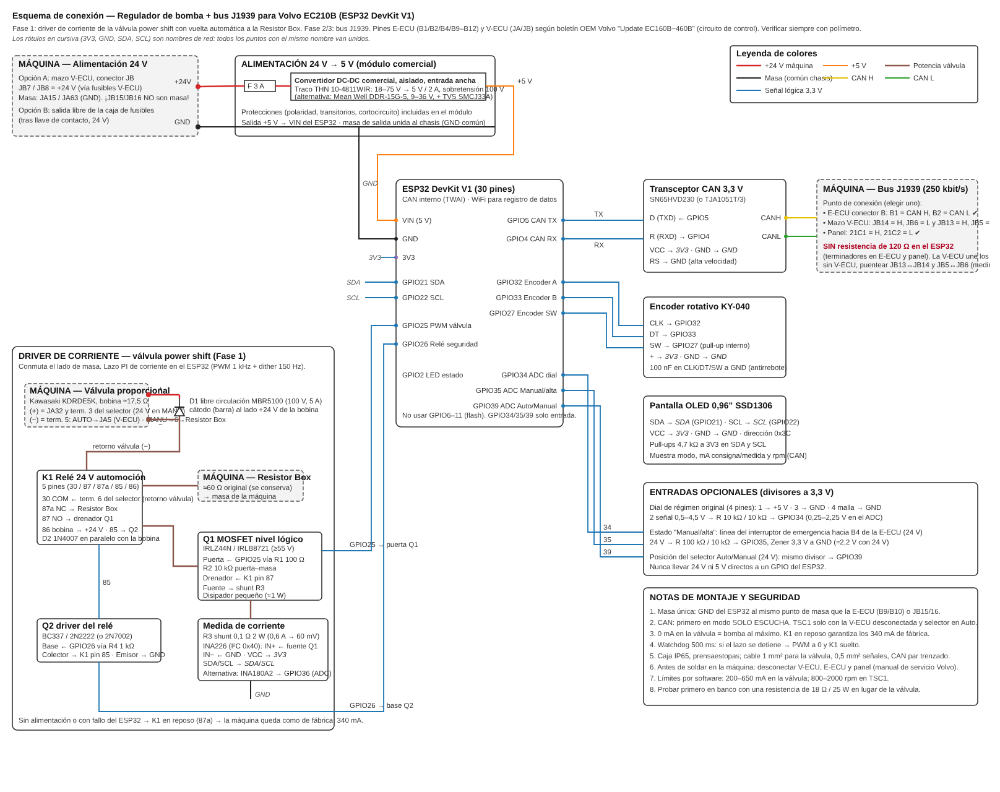

Diseño propio (fuente editable: `docs/esquema_conexion_ESP32.svg`). Bloques:
- **Alimentación 24 V protegida**: fusible 3 A, protección contra polaridad invertida, TVS SMCJ33A y DC-DC de entrada ancha (9–72 V → 5 V) hasta el VIN del ESP32. Masa común con el chasis.
- **Driver de corriente de la válvula power shift** (Fase 1): MOSFET IRLZ44N en el lado de masa, shunt de 0,1 Ω medido con INA226 (I²C), diodo de libre circulación MBR5100 sobre la bobina, PWM 1 kHz + dither 150 Hz y lazo PI en el ESP32.
- **Relé de seguridad K1**: en reposo (NC) conecta la **Resistor Box original** (≈340 mA, como de fábrica); solo cuando el ESP32 arranca bien y el watchdog está armado conmuta al MOSFET. Un fallo del ESP32 devuelve la máquina al modo Manual de fábrica.
- **Bus J1939**: transceptor SN65HVD230 (3,3 V) en GPIO5/GPIO4, conectado a B1/B2 de la E-ECU o a los pares JB14/JB6 · JB13/JB5 del mazo de la V-ECU. **Sin resistencia de 120 Ω**: ya están en la E-ECU y en el panel.
- **Interfaz**: encoder KY-040 y OLED SSD1306; entradas opcionales con divisor para el dial original (0,5–4,5 V), el estado del interruptor de emergencia (B4) y el selector Auto/Manual.

Tablas de pines (ESP32 y Arduino Nano), puntos de conexión y lista de materiales: [`docs/ESQUEMA_CONEXION.md`](docs/ESQUEMA_CONEXION.md).

### 2. Circuito de control OEM de la EC160B–EC460B (boletín Volvo "UPDATE EC160B~460B")

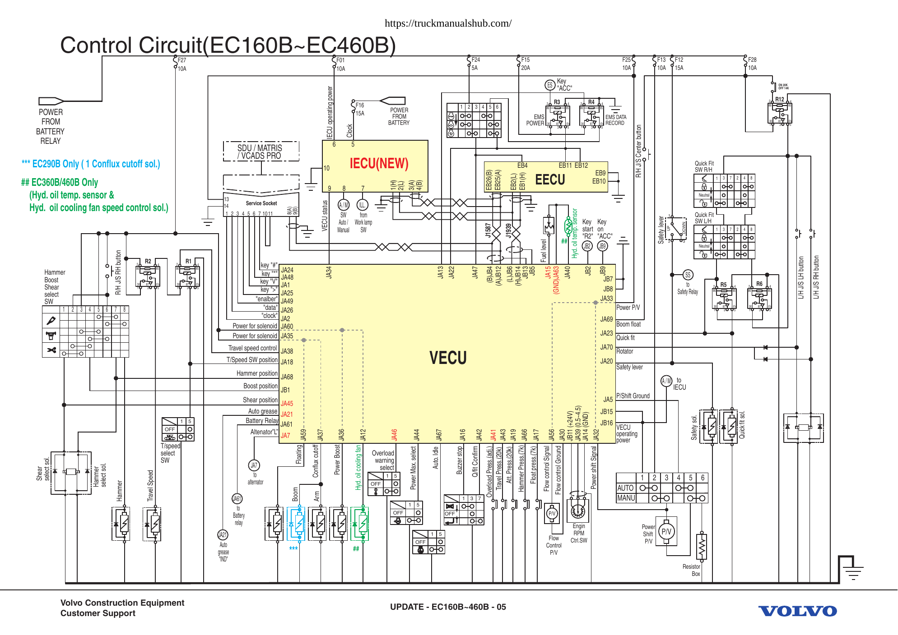

La página más valiosa de toda la investigación: **pinout completo de la V-ECU** (conectores JA de 70 y JB de 16 pines), fusibles, relés R3/R4 del EMS, dial de régimen, válvulas y presostatos. Versión a 300 dpi: `docs/esquemas/ce_EC-B_UPDATE_p06_control_circuit_300dpi.png`. Lo que se extrae de ella:
- +24 V de la V-ECU en **JB7/JB8**; masa en **JA15/JA63**; llave en JB2 (START) y JB9 (ON).
- J1939 en **JB14 (H) / JB6 (L)** y **JB13 (H) / JB5 (L)**; J1587 en JB12 (A) / JB4 (B).
- Dial de régimen: JB11 (+24 V), **JA39 (señal 0,5–4,5 V)**, JA14 (masa).
- Válvula power shift: **JA32 "Power shift Signal" (+)** y **JA5 "P/Shift Ground"** (PWM en el lado de masa).

#### 2a. Selector Auto/Manual, válvula y Resistor Box (ampliaciones)

| 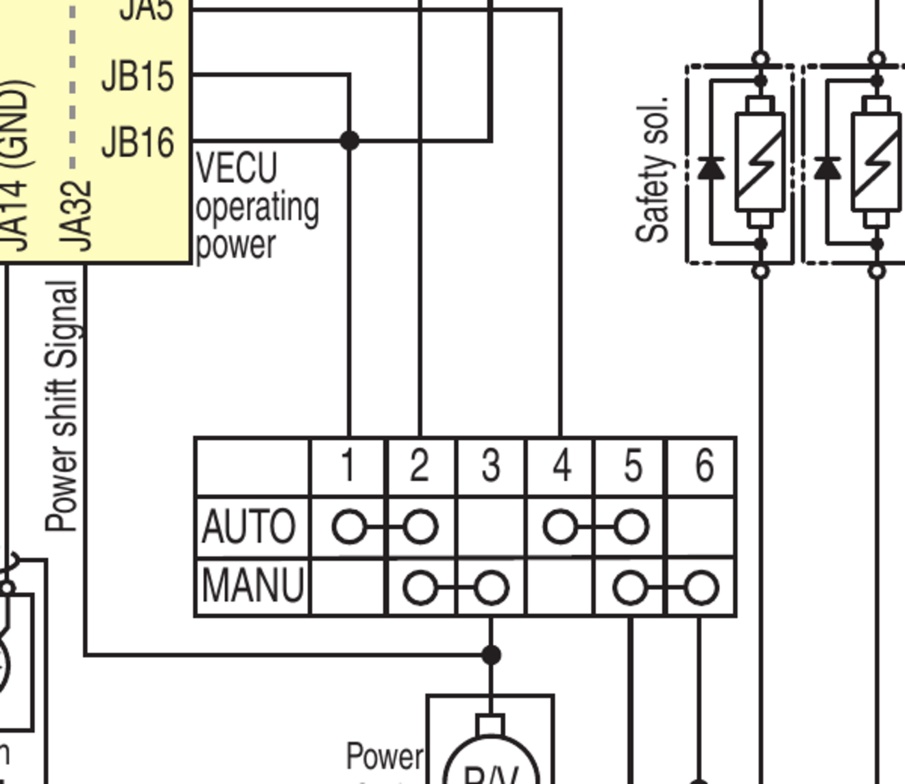 | 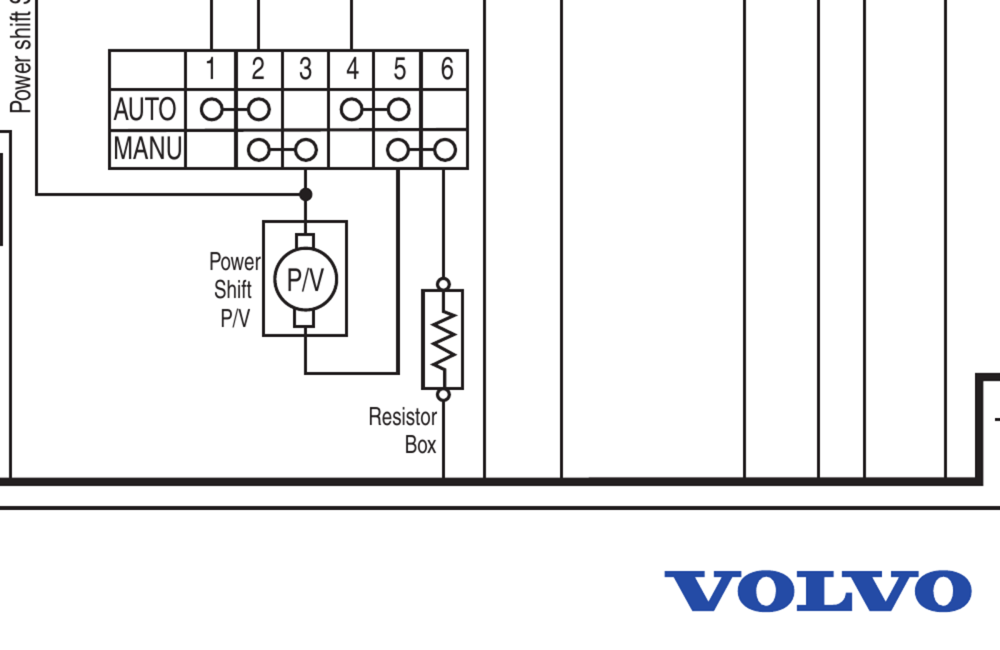 |
|---|---|

El selector tiene 6 terminales: **AUTO cierra 1–2 y 4–5; MANU cierra 2–3 y 5–6**. Terminal 1 = JB15, 2 = JB16 (y señal de posición al panel), **3 = válvula (+) y JA32**, **4 = JA5**, **5 = válvula (−)**, **6 = Resistor Box → masa**. En Auto la V-ECU regula la corriente de la válvula por el lado de masa (JA5), exactamente la topología de nuestro driver. En Manual la válvula se alimenta a 24 V por 2–3 y retorna por 6 → Resistor Box (≈60 Ω → ≈340 mA): **el driver del ESP32 se intercala entre el terminal 6 y masa.**

#### 2b. Pines del bus en la V-ECU

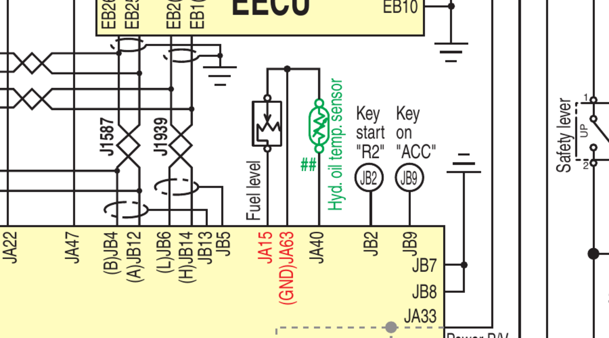

Dos pares J1939 entran en la V-ECU: uno desde la E-ECU (EB1/EB2) y otro hacia el panel. La V-ECU es **nodo de paso**: con ella desenchufada, la E-ECU y el panel pueden quedar separados, cada uno con una sola terminación. Hay que medir CAN H–L con la V-ECU fuera y, si da 120 Ω, **puentear JB13↔JB14 y JB5↔JB6** en el adaptador.

#### 2c. Interruptor de régimen de emergencia

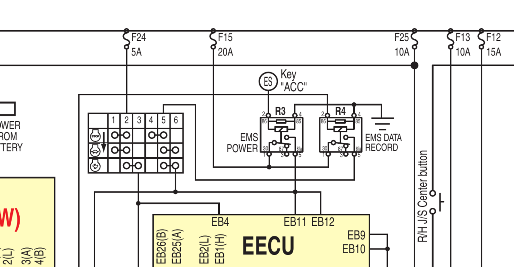

El fusible **F24 (5 A)** alimenta el terminal 2 del interruptor de 3 posiciones. STOP cierra 1–2 y 4–5; ralentí 1–2 y 5–6; **alto cierra 2–3 y 5–6**: el terminal 3 lleva +24 V al pin **EB4** de la E-ECU. En los camiones Volvo con esta misma centralita EB4 es la entrada "idle validation" (< 4 V ralentí, > 8 V alto): es una entrada de **dos estados**, por eso no permite regulación continua. El contacto 4–5 de STOP actúa sobre los relés R3 "EMS power" y R4 "EMS data record" para parar el motor con la llave quitada.

### 2d. Pinout del conector B de la E-ECU y conexión al ESP32

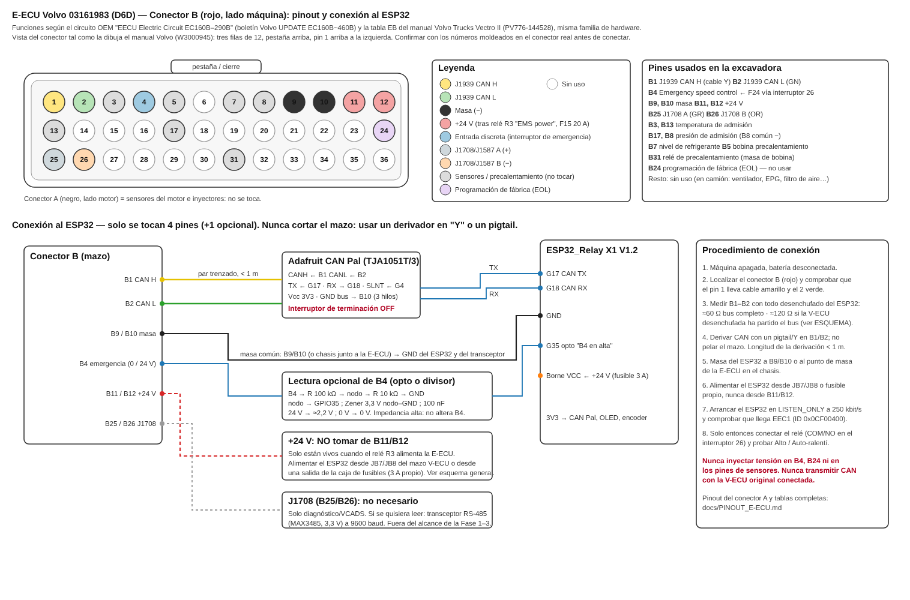

Diagrama propio a partir del circuito OEM y de la tabla EB del manual Vectro II. Del conector de 36 pines **solo se tocan cuatro**: **B1 (CAN H, amarillo)** y **B2 (CAN L, verde)** al módulo CAN (**Adafruit CAN Pal** con la terminación en OFF), **B10 (o B9) (masa)** al borne GND del CAN Pal como masa común (cable de 3 hilos), y opcionalmente **B4** (estado del interruptor de emergencia) a través del optoacoplador hacia GPIO35. **No** se alimenta el ESP32 desde B11/B12 (solo viven con el relé R3 activo) ni se conecta nada en B24 (programación de fábrica) o en los pines de sensores. Tablas completas de los conectores A y B, colores de cable y procedimiento de conexión en [`docs/PINOUT_E-ECU.md`](docs/PINOUT_E-ECU.md).

### 3. Circuito OEM de la E-ECU (motor D6D, EC160B–290B)

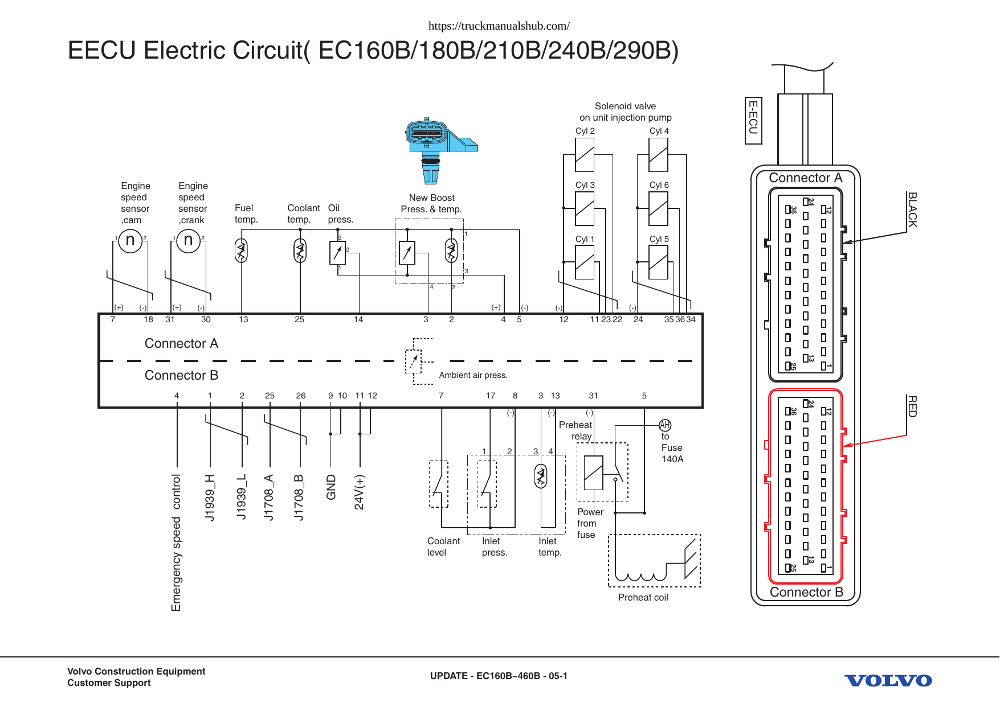

Del mismo boletín. **Conector B (rojo, lado máquina)**: B1 CAN H, B2 CAN L, B25/B26 J1708 A/B, B9/B10 masa, B11/B12 +24 V, **B4 Emergency speed control**, B31 relé de precalentamiento, B5 bobina de precalentamiento, B7/B17/B8/B3/B13 sensores. **Conector A (negro, lado motor)**: sensores de régimen (cigüeñal 30/31, árbol de levas 7/18), temperaturas, presiones y las seis electroválvulas de las bombas unitarias. La numeración de los 36 pines (1–12 / 13–24 / 25–36) aparece en el dibujo de los conectores.

### 4. Entradas y salidas de la V-ECU (visión funcional)

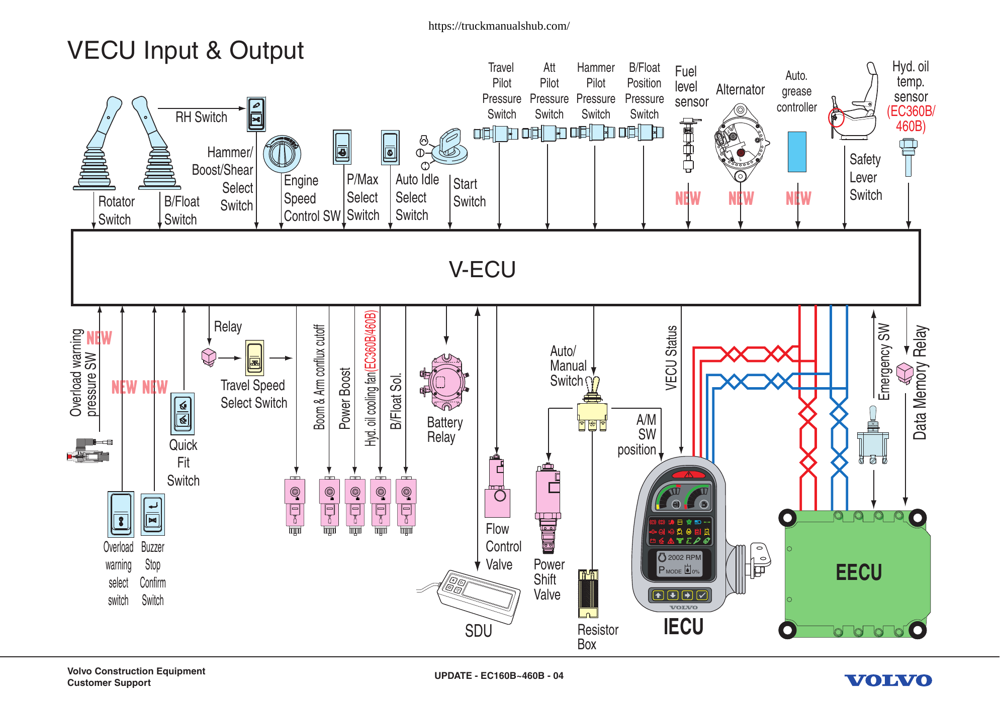

Todo lo que la V-ECU lee y gobierna: joysticks, dial de régimen, P/Max, auto-ralentí, presostatos, nivel de combustible, alternador; y como salidas la válvula power shift, la válvula de caudal, power boost, conflux cut-off, flotación, traslación, relé de batería, "VECU STATUS" al panel y los dos buses hacia la E-ECU. Sirve de inventario de lo que un emulador completo tendría que reproducir; **la Fase 1 solo sustituye la rama power shift**.

### 5. Visión general del sistema electrónico

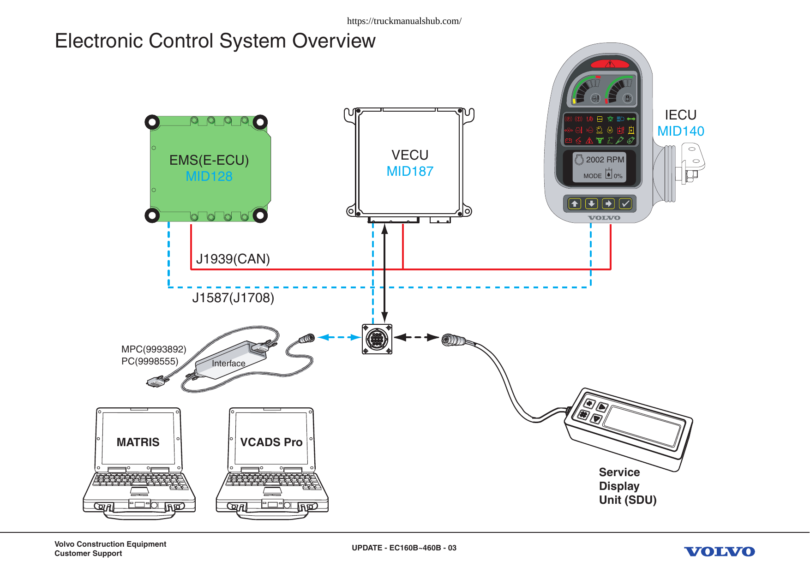

Tres unidades y dos buses: **E-ECU (MID 128)**, **V-ECU (MID 187)** y panel **I-ECU (MID 140)**, unidas por **J1939 (CAN, control)** y **J1587/J1708 (información y diagnóstico)**, con la toma de servicio para VCADS Pro / MATRIS / SDU. La toma de servicio solo lleva J1587 y alimentación: el CAN hay que pincharlo en la E-ECU o en el mazo de la V-ECU.

### 6. Esquema L120E: misma E-ECU, terminador del bus

| 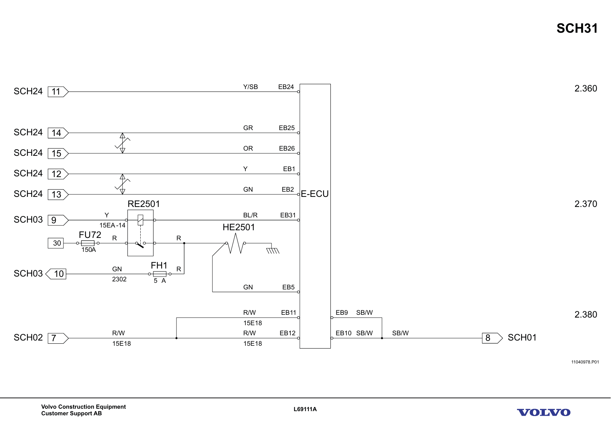 | 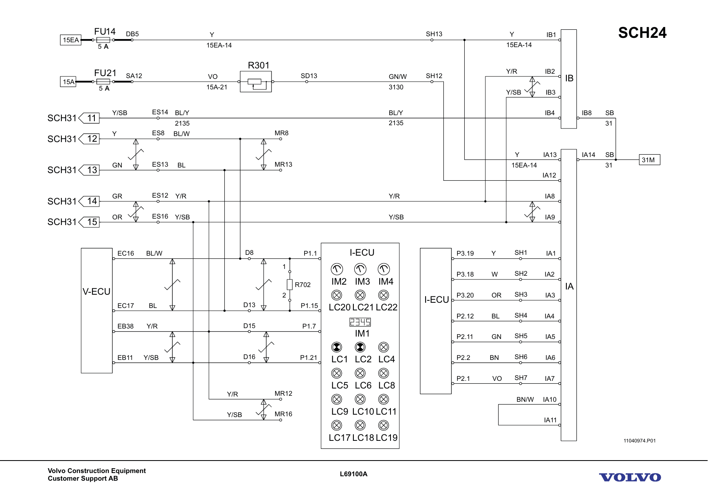 |
|---|---|

Esquemas Volvo de la cargadora L120E, que monta la misma E-ECU 03161983. **SCH31** confirma el conector EB con los colores de cable (CAN amarillo/verde, J1708 gris/naranja, alimentación rojo-blanco, masa negro-blanco). **SCH24** muestra la resistencia de terminación **R702 (120 Ω) dentro del panel I-ECU**; la otra está en la E-ECU.

### 7. Code Lock (antirrobo)

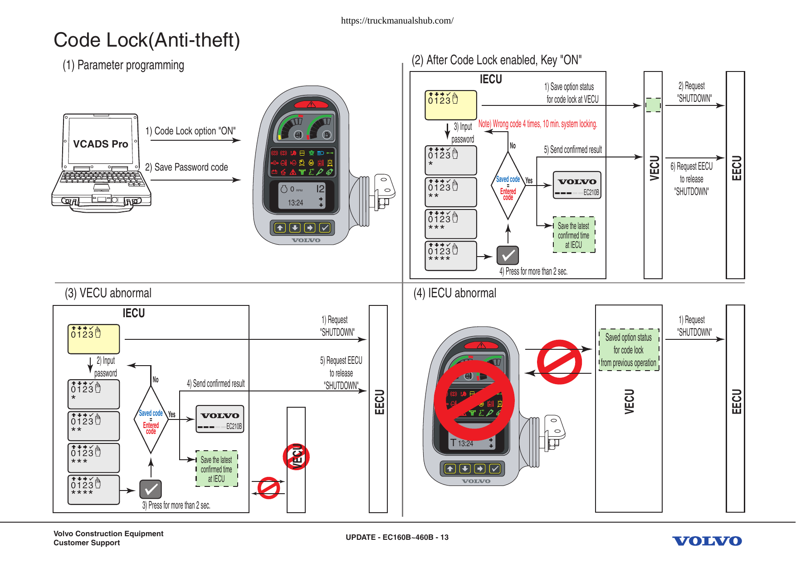

Es opcional, se activa con VCADS Pro y funciona por CAN: el panel pide "SHUTDOWN" a la E-ECU hasta que se introduce el código, y la V-ECU guarda el estado de la opción. No hay emparejamiento fijo V-ECU↔E-ECU. La máquina del proyecto (2002, con pantalla MDU anterior al I-ECU) arranca en Manual, así que no lo tiene activo.

### 8. Pinouts de la EECU de camión Volvo D12 (misma familia de hardware)

| 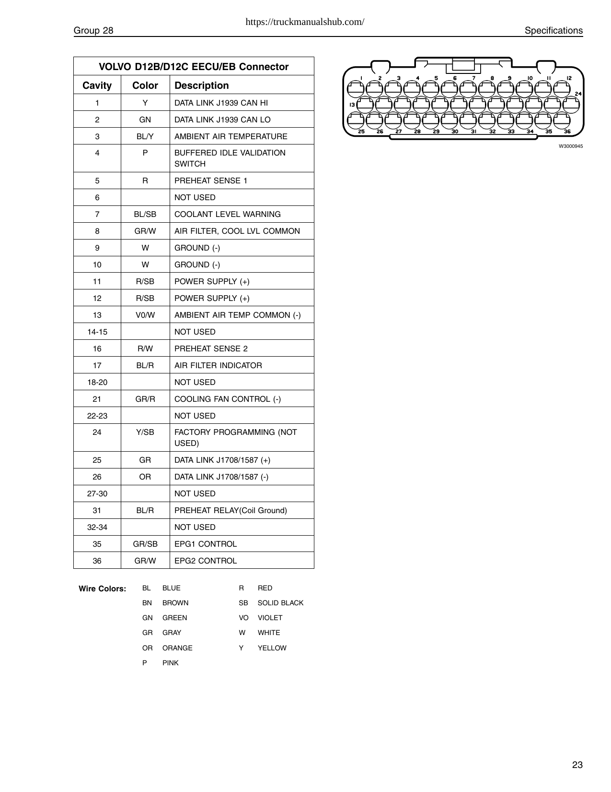 | 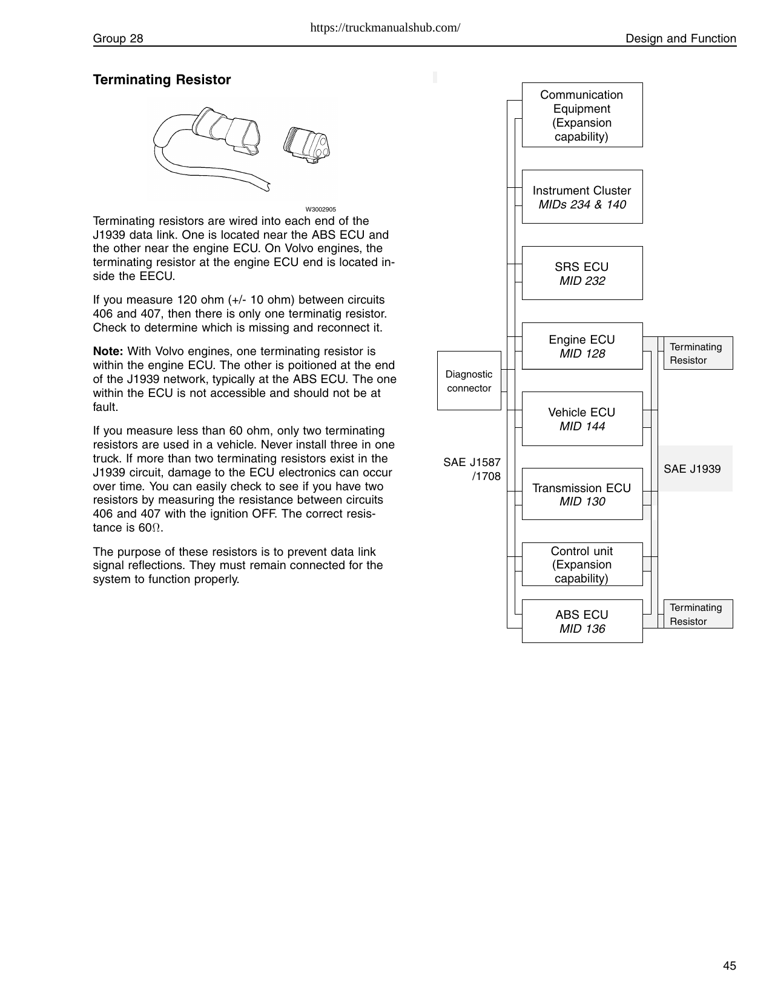 |
|---|---|

Del manual Volvo Trucks "Vectro II" (PV776-144528). El conector EB del camión coincide pin a pin con el conector B de la E-ECU de la excavadora, lo que confirma la familia LucasVarity. También documenta cómo la VECU del camión manda el régimen a la EECU por J1939 y qué pasa cuando se pierde esa comunicación (SID 231 / PSID 201, "limp home" por la línea cableada EB4).

## Seguridad

- Pruebas siempre con la máquina **estacionada**, palanca de seguridad bloqueada y el equipo apoyado.
- Con la válvula a **0 mA la bomba absorbe el máximo** y puede calar el motor: el relé de seguridad en reposo mantiene la Resistor Box de fábrica.
- Transmitir por CAN **solo** tras una captura en modo escucha, con la V-ECU original desconectada y el selector en Auto.
- Límites por software: 200–650 mA en la válvula, 800–2000 rpm en TSC1.
- El firmware arranca siempre en **Reposo** (manda el interruptor original), lleva watchdog de 500 ms, y la **pulsación larga del encoder** vuelve a Reposo en cualquier momento.

## Fiabilidad de la información

Cada dato de la documentación lleva su fuente y una etiqueta: **ALTA** (documento Volvo/Deutz/norma SAE), **MEDIA** (documento OEM reconstruido o fabricante de componentes/integrador) o **BAJA** (foro, vendedor). Lo no confirmado se señala como **INFERIDO** o **NO ENCONTRADO**. Volvo no publica el protocolo propietario V-ECU↔E-ECU: los mensajes CAN de la Fase 3 deben verificarse en la máquina.

## Licencia y avisos

Código y documentación propios: ver `LICENSE` (pendiente de elegir). Las imágenes de `docs/esquemas/` son extractos de documentación de Volvo CE, Volvo Trucks, Volvo Penta, Deutz y de fabricantes de controladores, reproducidos con fines de estudio y reparación; los derechos pertenecen a sus titulares. Los manuales completos **no** se incluyen en el repositorio: `docs/manuales/README.md` indica dónde obtenerlos.
