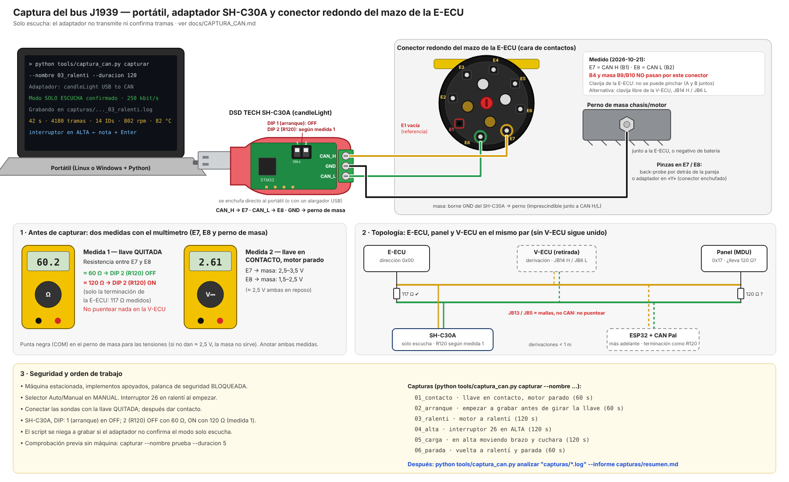
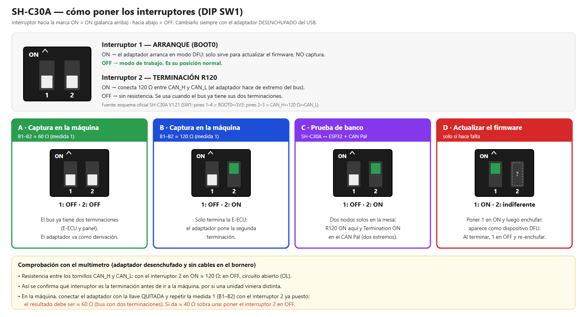
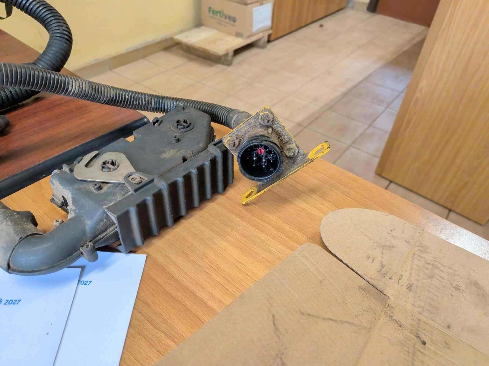

# Captura del bus J1939 con el portátil

Fase 1 de [`CONTROL_RPM.md`](CONTROL_RPM.md): **escuchar** el bus CAN de la máquina, sin transmitir nada, para saber qué publica la E-ECU, qué averías marca sin V-ECU y cuánto par da con y sin carga. Con esos datos se ajusta el auto-ralentí y se decide si se puede probar TSC1 (regulación continua de rpm).



Diagrama de conexiones (fuente: [`esquema_captura_CAN.svg`](esquema_captura_CAN.svg), generado con `tools/gen_esquema_captura.py`).

## Material

- Portátil de pruebas con Linux (CachyOS, ya preparado) o, como alternativa, Windows con Python 3.
- Adaptador **DSD TECH SH-C30A** ([B0BQ5G3KLR](https://www.amazon.es/dp/B0BQ5G3KLR)): basado en CANable, firmware **candleLight** de fábrica. Se enchufa **directo por USB-A** al portátil (o con un alargador USB). Bornero de 3 tornillos, de arriba abajo **CAN_H · GND · CAN_L**; un **DIP de 2 interruptores** junto al bornero: **1 = arranque** (ON = modo DFU para actualizar el firmware, **OFF = modo de trabajo**) y **2 = terminación R120** (ON = 120 Ω entre CAN_H y CAN_L). Asignación sacada del esquema oficial (SW1, SH-C30A V1.21).



Configuración del DIP para cada caso (fuente: [`esquema_switches_SH-C30A.svg`](esquema_switches_SH-C30A.svg), generado con `tools/gen_switches_shc30a.py`). Antes de ir a la máquina, comprobar con el multímetro que el interruptor 2 es la terminación: CAN_H–CAN_L ≈ 120 Ω con 2 en ON y abierto con 2 en OFF.
- Tres sondas back-probe (B9 de la lista de compra) y multímetro.

## 0. Seguridad

- Máquina **estacionada**, implementos apoyados, **palanca de seguridad bloqueada**.
- Selector Auto/Manual en **MANUAL**.
- **Solo escuchar.** El script abre el adaptador en modo *listen-only* y **se niega a capturar** si el adaptador no lo admite: en ese modo no transmite ni confirma tramas, así que es invisible para la E-ECU.

## 1. Mediciones con el multímetro (conector B de la E-ECU, sin desconectar nada)

Topología (circuito OEM, `esquemas/ce_EC-B_UPDATE_p06_zoom_bus_J1939_J1587_pines_VECU.png`): E-ECU (B1/B2), panel y V-ECU (JB14 H / JB6 L) están **empalmados en el mismo par**. Sin la V-ECU el bus E-ECU ↔ panel sigue unido; **no hay que puentear nada** en el conector de la V-ECU (JB13 y JB5 son las mallas de los cables, no CAN).

| Paso | Condición | Medir | Esperado |
|---|---|---|---|
| 0 | En el taller, **E-ECU suelta** | Resistencia **B1–B2** en la propia E-ECU | ✅ **117 Ω medidos (2026-10-20)**: la E-ECU lleva su terminación de 120 Ω dentro |
| 1 | **Llave quitada**, E-ECU montada | Resistencia **B1–B2** | **≈ 60 Ω**: dos terminaciones (E-ECU y panel) → DIP 2 (R120) del SH-C30A en **OFF**. **≈ 120 Ω**: solo la de la E-ECU; el panel (MDU de 2002) no termina el bus o no está en él → DIP 2 (R120) en **ON**. **Anotarlo** |
| 1b | (opcional) Llave quitada, **E-ECU desenchufada** | Resistencia **B1–B2** en la clavija del mazo | **≈ 120 Ω**: terminación del panel. **Abierto**: no hay otra terminación en el mazo |
| 2 | **Llave en contacto**, motor parado | Tensión **B1→B9** (CAN H) y **B2→B9** (CAN L) | ≈ 2,5 V ambas; con tráfico, CAN H 2,5–3,5 V y CAN L 1,5–2,5 V. El pin más alto es **CAN H** (tornillo de arriba del SH-C30A) |

## 2. Preparar el portátil (una vez)

### Linux (portátil de pruebas)

Entorno de Python del proyecto en `.venv` (PlatformIO para el firmware y las librerías de captura), creado con `uv`. **Ya está hecho en el portátil**; para repetirlo en otro equipo:

```bash
uv venv .venv && uv pip install --python .venv/bin/python -r tools/requirements.txt
```

Permisos USB del adaptador CAN y del programador del ESP32 (pide la contraseña de `sudo`; **ya instalados en el portátil**):

```bash
sh tools/linux/instalar_permisos.sh
```

El entorno trae también las herramientas de `python-can` (`can_logger`, `can_viewer`), por si hace falta mirar el bus de otra forma; `can-utils` (`candump`) no está en los repositorios de CachyOS y no es necesario.

Antes de cada sesión, desde la carpeta del repositorio, activar el entorno (en fish; en bash `source .venv/bin/activate`); a partir de ahí `python` es el del proyecto y valen todas las órdenes de esta guía:

```bash
source .venv/bin/activate.fish
```

Accesos en el escritorio para los dos paneles (**Panel bus J1939** y **Panel placa ESP32**; ya creados en el portátil): `sh tools/linux/instalar_accesos.sh`. Cada uno abre una ventana de terminal con el panel y el navegador; cerrar la ventana lo para.

En Linux el kernel toma el SH-C30A como interfaz `can0` (driver `gs_usb`); el script lo libera solo al abrirlo, no hay que hacer nada.

### Windows (alternativa)

```bash
python -m pip install --user gs_usb pyusb libusb-package
```

Con candleLight, Windows suele cargar el driver WinUSB solo. Si el script dice que no encuentra el adaptador, abrir **Zadig** (zadig.akeo.ie), elegir el dispositivo «candleLight USB to CAN adapter» e instalar **WinUSB**.

### Comprobación sin máquina

Enchufar el SH-C30A con el **DIP 1 (arranque) en OFF** (en ON arranca en modo DFU y no captura). Debe decir «Modo SOLO ESCUCHA confirmado»:

```bash
python tools/captura_can.py capturar --nombre prueba --duracion 5
```

## 3. Conexión a la máquina

| SH-C30A | Conector B de la E-ECU | Notas |
|---|---|---|
| CAN_H (tornillo de arriba) | **B1** (amarillo) | back-probe |
| GND (tornillo del medio) | **B9** (o B10), **o cualquier masa buena cerca de la E-ECU**: perno de masa del chasis/motor o negativo de batería | pinza o terminal de anillo. **Imprescindible**: el SH-C30A va alimentado por el USB del portátil y sin esta masa no tiene referencia común con el bus |
| CAN_L (tornillo de abajo) | **B2** (verde) | back-probe |
| DIP **1** (arranque) · DIP **2** (R120) | 1 **OFF** siempre · 2 **OFF** si B1–B2 ≈ 60 Ω, **ON** si ≈ 120 Ω | el bus debe quedar con dos terminaciones (paso 1) |

Alternativa: JB14 / JB6 en el mazo de la V-ECU. Conectar **antes** de dar contacto.

### 3b. Punto de acceso en estudio: conector redondo del mazo de la E-ECU



En la clavija del mazo de la E-ECU (carcasa negra con aletas, palanca de cierre metálica) los cables quedan tapados por la tapa trasera, así que el back-probe de B1/B2/B9 no es cómodo. Del mismo mazo sale un **conector redondo** sujeto a una escuadra amarilla (centro con llave roja, ≈ 8–9 contactos): si lleva el par J1939, es el mejor punto para conectar el SH-C30A con un **adaptador en "Y"** sin tocar la E-ECU.

**Pines que hacen falta de este conector:**

| Señal | Equivale a | Para qué | ¿Imprescindible? |
|---|---|---|---|
| **CAN H** | B1 (amarillo) | Captura del bus y firmware | Sí |
| **CAN L** | B2 (verde) | Captura del bus y firmware | Sí |
| **Masa** | B9 / B10 | Referencia común del CAN | Sí |
| Línea **B4** (emergency speed) | B4 | Vía B: el relé pone 24 V aquí (1900 rpm). Si no pasa por este conector, el relé se conecta en el interruptor 26 como hasta ahora | Solo para la vía B |
| **+24 V tras la llave** | — (no B11/B12) | Alimentar la placa ESP32 y el COM del relé, con fusible propio. Si no está, se toma de JB7/JB8 o de la caja de fusibles | Opcional |

No hacen falta: J1708 (B25/B26), alimentación de la E-ECU (B11/B12, solo viva con el relé R3), B24 (programación de fábrica) ni los pines de sensores.

**Identificación probable: conector MC02 ("mazo del EMS")** [INFERIDO, fiabilidad MEDIA]

El esquema Volvo **SCH02-1** de la EC160B–EC290B (`esquemas/ce_EC160B-290B_SCH02-1_zoom_conector_MC02_CAN_J1587_emergencia.png`) muestra que el bus y la señal de emergencia pasan por un conector **MC02** entre la E-ECU y la cabina, y la lista de conectores de la EC210B (Anexo A/F) describe **MC02** como «conectado al mazo del EMS» (el mazo de la E-ECU). El conector redondo de la foto sale justo de ese mazo, así que muy probablemente es **MC02**:

| Pin MC02 | Cable (lado cabina) | Señal | Va a la V-ECU | Equivale en la E-ECU |
|---|---|---|---|---|
| **MC02.2** | amarillo (Y), C50 | **CAN H** | JB14 | B1 |
| **MC02.3** | verde (GN), C51 | **CAN L** | JB6 | B2 |
| MC02.4 | rojo (R), C52 | J1587 A | JB12 | B25 |
| MC02.5 | blanco (W), C53 | J1587 B | JB4 | B26 |
| **MC02.1** | azul/blanco (BL/W), C61 | **Emergencia (B4)**: viene del interruptor 26 (SW2704, posición alta) y también llega a la V-ECU (JA47) | JA47 | B4 |

- Los pares CAN y J1587 llevan malla (JB13 y JB5 en la V-ECU son las mallas).
- La **masa no aparece en MC02** en esa hoja: el GND del SH-C30A se sigue tomando en B9/B10 o en el perno de masa junto a la E-ECU.
- El esquema es de máquinas con I-ECU (serie posterior a la nuestra) y puede tener más pines de los que se ven en esa hoja; **confirmarlo con el multímetro** antes de conectar nada.

**Comprobación en la máquina** (no hay datos de este conector en la documentación consultada más allá de esa hoja):
1. Fabricante y serie (posible Deutsch HD10/HD16 de 9 vías, como la toma J1939 de diagnóstico, o conector propio de Volvo): mirar marcas en la carcasa y las letras A, B, C… junto a cada contacto.
2. Qué pines son **CAN H, CAN L y masa**, con la E-ECU **desenchufada** y la llave quitada:
   - Continuidad entre la cara de la clavija de la E-ECU (**B1, B2, B9/B10**) y cada contacto del conector redondo.
   - Comprobación cruzada: con la E-ECU **enchufada**, la resistencia entre los dos pines del par CAN debe dar **≈ 117 Ω** (su terminación interna) o ≈ 60 Ω si el panel también termina.
   - Con contacto: ≈ 2,5 V en CAN H y en CAN L respecto a masa.
3. Colores: CAN H amarillo, CAN L verde (según los esquemas de la misma E-ECU).
4. A qué va conectado el otro lado (mazo de cabina, toma de diagnóstico, panel…).

Con el conector identificado se compra la pareja (o un cable de diagnóstico J1939 de 9 pines si es Deutsch HD) y se hace el adaptador; la tabla de conexión de arriba se rellena con los pines de este conector.

### 3c. Cómo conectarse sin cortar cables

La clavija de la E-ECU no sirve como punto de conexión: los conectores A y B van juntos en la misma carcasa y no se puede pinchar por detrás. Opciones, de mejor a peor:

| # | Dónde | Cómo | Ventajas | Inconvenientes |
|---|---|---|---|---|
| **1** | **Clavija del mazo de la V-ECU** (JA 70 / JB 16), que está libre porque la V-ECU no está montada | Pines macho de prueba del calibre correcto metidos por la **cara** de los contactos hembra, o una cabecera recuperada de una V-ECU averiada | No se corta ni se extrae nada; **están todas las señales**: CAN H **JB14**, CAN L **JB6**, emergencia/B4 **JA47** (mismo cable que MC02.1), +24 V **JB7/JB8**, masa **JA15/JA63** (mallas JB13/JB5). Es justo donde iba la V-ECU | Hay que identificar el tamaño de los contactos para no abrirlos; para el montaje definitivo hace falta una cabecera macho fija |
| **2** | **Adaptador en "Y" en el conector redondo (MC02)** | Comprar la pareja macho + hembra del conector, hacer un latiguillo intermedio y sacar CAN H/L (y B4) de él | Reversible, profesional y limpio; se enchufa y desenchufa en segundos | Hay que identificar el conector (marca y serie) para comprar la pareja |
| 3 | Conector redondo por detrás (back-probe) | Agujas finas por la junta trasera de MC02.2 y MC02.3 | Rápido para la **captura** de una sola vez | Puede dañar la junta estanca; no vale como montaje definitivo |
| 4 | Extraer contactos del conector redondo | Herramienta de extracción y contactos sueltos | Sin cortar | Riesgo de dañar contactos o retenciones; desaconsejado |

**Recomendación:** opción 1 para la captura y para el montaje (el ESP32 ocupa el sitio de la V-ECU), y opción 2 si la clavija de la V-ECU resulta incómoda o sus contactos no admiten pines de prueba.

Comprobaciones antes de usar la clavija de la V-ECU (llave quitada):
1. Continuidad **JB14 ↔ B1** (o MC02.2), **JB6 ↔ B2** (o MC02.3) y **JA47 ↔ B4** (o MC02.1).
2. Resistencia **JB14–JB6**: ≈ 117 Ω o ≈ 60 Ω con la E-ECU enchufada.
3. Con contacto: **JB7/JB8 ≈ 24 V** respecto a **JA15/JA63**; JB14 y JB6 ≈ 2,5 V.

## 4. Capturas (un fichero por prueba)

### Con el panel en el navegador (recomendado)

```bash
python tools/panel_bus.py
```

Abre `http://127.0.0.1:8766` con el bus en directo, **siempre en solo escucha**: rpm, par real, carga, temperaturas, presión de aceite, batería y horas; gráficas de rpm y par (la del par sirve para elegir el umbral del auto-ralentí); averías DM1 con sus lámparas; nodos presentes, con aviso si aparece la V-ECU (0x11), algún TSC1 o si la E-ECU está sola en el bus; y la tabla de mensajes con los bytes que cambian. Las **6 pruebas** de la tabla de abajo tienen su botón (nombre y duración ya puestos); las **notas** se marcan con un botón o escribiendo, y quedan en el fichero y en las gráficas. Al terminar, **Analizar** muestra el mismo informe que el paso 5. Los ficheros son idénticos a los de `captura_can.py`.

Arriba del panel hay una **guía paso a paso** con todo este procedimiento (seguridad, comprobar el SH-C30A, medidas, conexión, contacto, las 6 capturas y el análisis): en cada paso dice qué hacer, **qué debería verse** en el multímetro y en el panel, y comprueba en directo lo que se puede (llegan tramas, aparece la E-ECU, rpm ≈ 800 / 1900…). Las medidas del multímetro se apuntan en la guía y quedan en el registro; la medida de B1–B2 decide sola la posición del DIP 2 que indica el paso de conexión.

**Registro automático:** sin pulsar nada, cada sesión del panel se guarda en `registros/bus/<fecha>_<hora>/`: `bus_completo.log` (todas las tramas y notas de la sesión, mismo formato que las capturas: se analiza con `captura_can.py analizar` o se repasa con `--reproducir`), `motor.csv` (un valor por segundo: rpm, par, carga, refrigerante, aceite, batería, tramas/s y notas) y `eventos.log` (conexiones, nodos nuevos, averías que aparecen o desaparecen, TSC1 o V-ECU detectados, grabaciones, notas y un resumen cada 10 s). `--sin-registro` lo desactiva.

Para probarlo sin máquina: `python tools/panel_bus.py --demo` (E-ECU simulada; graba en `capturas/demo/`). Para repasar una captura ya hecha: `python tools/panel_bus.py --reproducir capturas/<fichero>.log`.

### Por línea de comandos

Cada captura se guarda en `capturas/<fecha>_<hora>_<nombre>.log`. Mientras graba, escribir una nota y pulsar **Enter** marca el momento (p. ej. «interruptor en ALTA», «muevo el brazo»). Ctrl+C para terminar.

| # | Situación | Orden | Para qué |
|---|---|---|---|
| 1 | Llave en contacto, motor parado | `capturar --nombre 01_contacto --duracion 60` | Mensajes sin motor, averías activas |
| 2 | **Arranque** (empezar antes de girar la llave) | `capturar --nombre 02_arranque --duracion 60` | Mensajes del arranque, si echa en falta la V-ECU |
| 3 | Ralentí (interruptor 26 en ralentí) | `capturar --nombre 03_ralenti --duracion 120` | rpm, temperatura, par en reposo |
| 4 | Interruptor 26 en **ALTA** | `capturar --nombre 04_alta --duracion 120` | 1900 rpm, cambios en otros mensajes |
| 5 | En alta **moviendo brazo y cuchara** | `capturar --nombre 05_carga --duracion 120` | Par con carga → umbral del auto-ralentí |
| 6 | Vuelta a ralentí y parada | `capturar --nombre 06_parada --duracion 60` | Comportamiento al bajar |

(Todas con `python tools/captura_can.py` delante.)

## 5. Análisis

```bash
python tools/captura_can.py analizar "capturas/*.log" --informe capturas/resumen.md
```

Por cada fichero sale: tabla de identificadores (PGN, quién lo envía, periodo, bytes que cambian), rpm y par de **EEC1**, temperatura de **ET1**, averías de **DM1** (también las multitrama), si hay **TSC1** en el bus y las notas con su tiempo. Los `.log` usan el formato de `candump -l`: también se abren con SavvyCAN o python-can.

## 6. Qué decidir con los resultados

- **Umbral de par del auto-ralentí** (`par <pct>` en la consola del firmware): entre el par a ralentí sin carga (prueba 3) y el de trabajo (prueba 5).
- **Averías sin V-ECU** (SID 231 / PSID 201 u otras): si aparecen, saber cuáles son normales.
- **Nodos presentes** (direcciones de origen): E-ECU 0x00, panel 0x17, ¿otros?
- **Si solo aparece la E-ECU y siempre la misma trama repetida**, nadie confirma (ACK) sus tramas: la E-ECU está sola en el bus (el SH-C30A en solo escucha no confirma). Entonces hará falta un nodo que confirme sin transmitir datos propios (el adaptador o el ESP32 en modo normal); decidirlo antes de seguir.
- Con todo ello, preparar la **Fase 2** (prueba de TSC1) de [`CONTROL_RPM.md`](CONTROL_RPM.md) §4.
