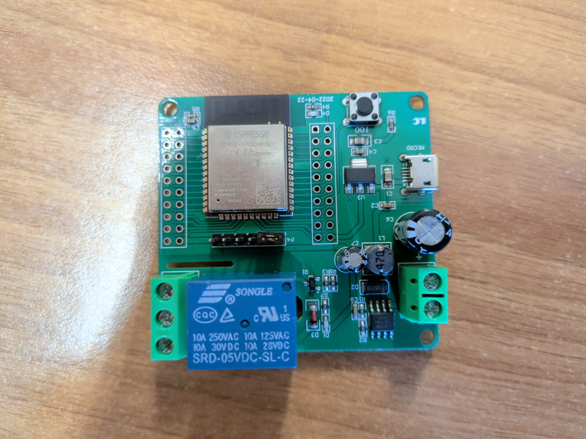
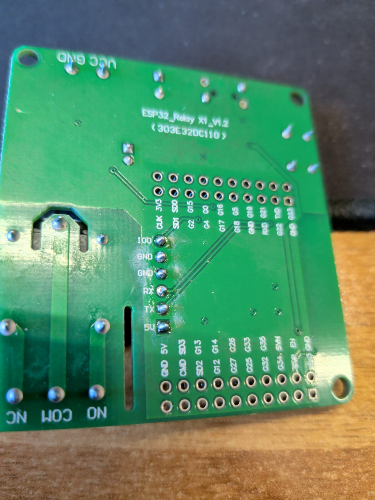
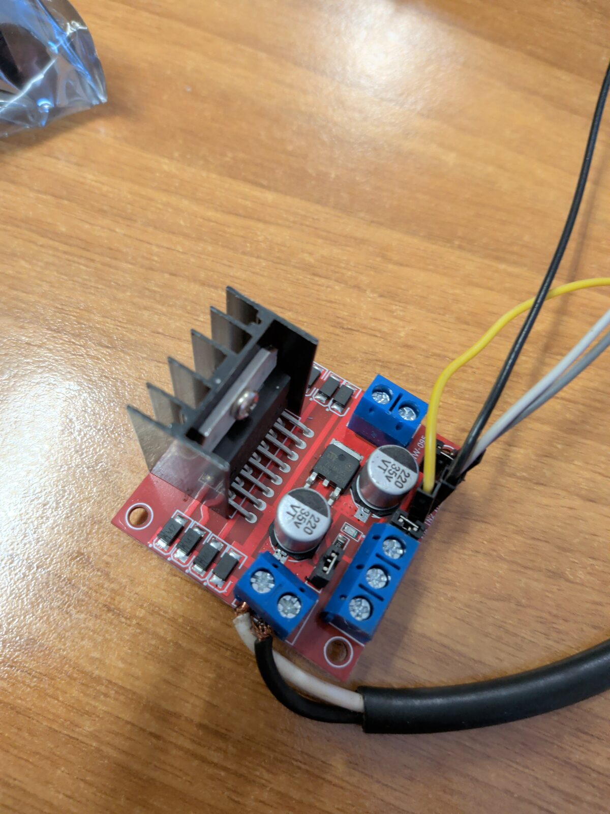
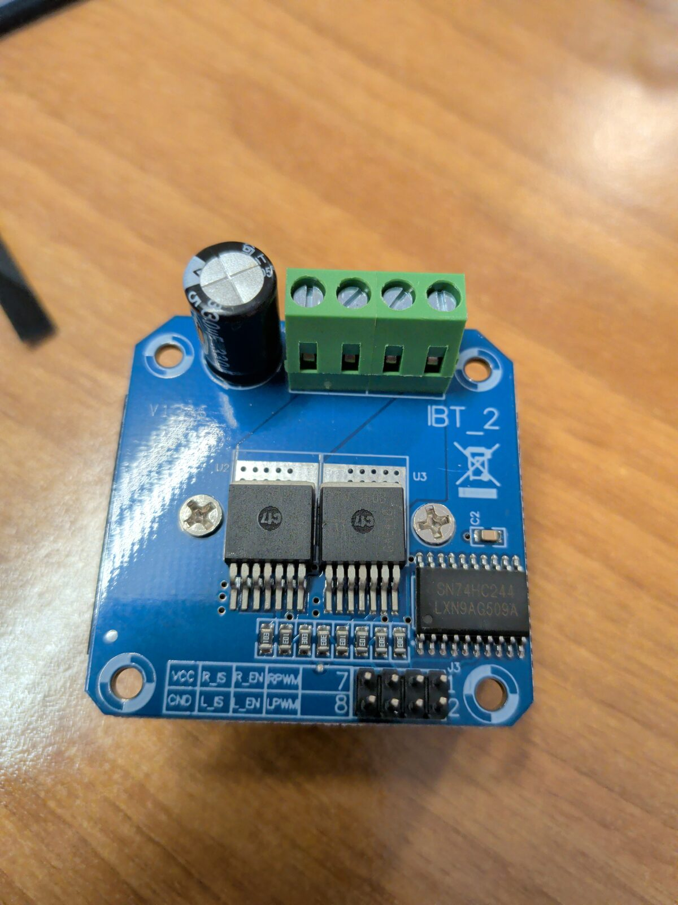
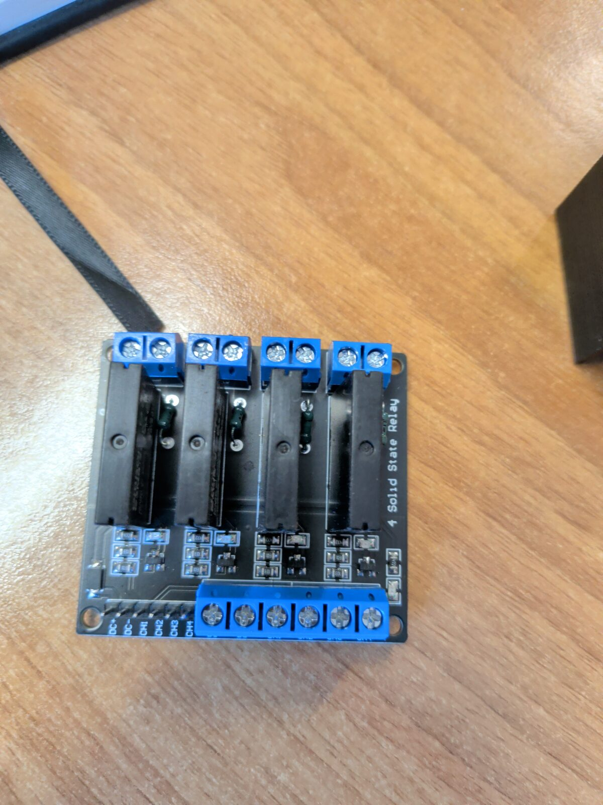
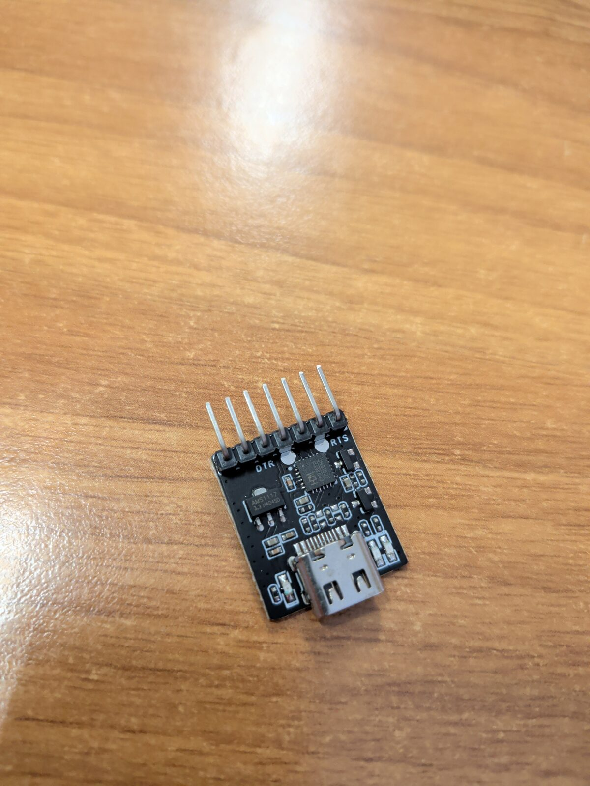
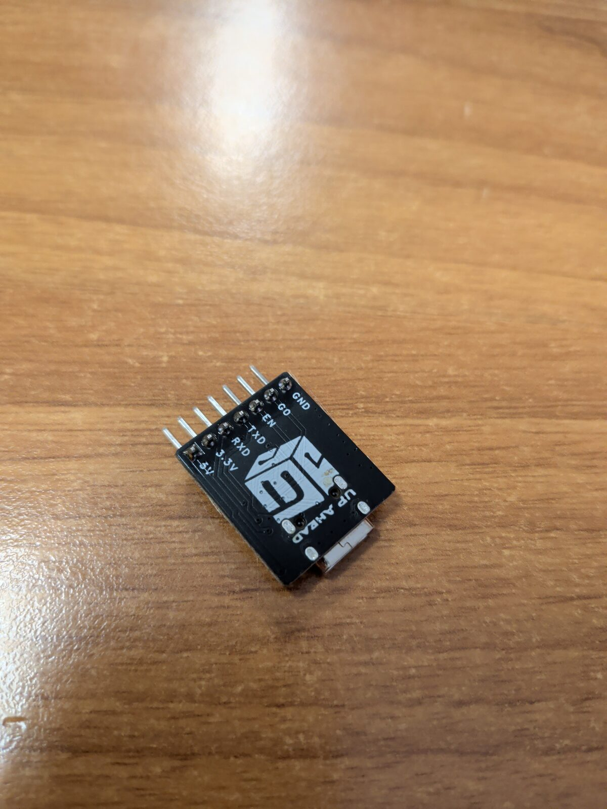

# Placa disponible: ESP32-WROOM-32E con relé (LC Technology, 2022-04-22)

## Qué se ve en la placa

| Elemento | Identificación (por la foto) | Para el proyecto |
|---|---|---|
| Módulo | **ESP32-WROOM-32E** (Espressif) | Tiene controlador CAN (TWAI) interno: solo hace falta el transceptor externo |
| Relé | **Songle SRD-05VDC-SL-C**, 10 A / 30 VDC, contactos **COM / NO / NC** en borne de 3 tornillos, mandado por transistor S8050 ("J3Y") | Sirve tal cual para la **vía B**: poner 24 V en la línea B4 (corriente de mA) |
| Alimentación | Borne de 2 tornillos **+ / −**, convertidor conmutado con bobina 470 µH, diodo SS210 y circuito integrado en SOIC-8 (**XL7005A**, a confirmar en la serigrafía: entrada 5–80 V, 0,4 A) + regulador 3,3 V (AMS1117, U3) | Se alimenta **directamente a 24 V** de la máquina. Si el chip es el XL7005A, aguanta 80 V: margen sobrado frente a los picos del alternador |
| USB micro | Sin chip USB-serie (no hay CH340/CP2102) | **Confirmado por el usuario: solo alimentación.** Para programar hace falta un **adaptador USB-TTL de 3,3 V** en el conector P4 (ver `LISTA_COMPRA.md`, A10) |
| P4 | Conector de 6 pines con un puente | **Confirmado (reverso): IO0 · GND · GND · RX · TX · 5V.** El puente probablemente une IO0–GND: quitarlo para el funcionamiento normal |
| Botón | **IO0** | Entrar en modo de carga de firmware: mantener pulsado al dar tensión |
| Filas de pines | Dos filas de **taladros sin soldar** a ambos lados del módulo | Hay que soldar tiras de pines para sacar los GPIO (CAN, I²C, encoder, optoacoplador) |
| Fecha / marca | 2022-04-22, logotipo LC; reverso: **ESP32_Relay X1_V1.2 (303E32DC110)** | LC Technology ESP32 Relay X1 V1.2 |

## ¿Sirve para el proyecto? Sí

Cubre de golpe tres módulos de la lista de compra: el **ESP32**, el **convertidor 24 → 5 V** y el **relé** de la vía B. Solo hay que añadir:

1. **Módulo transceptor CAN 3,3 V** (Adafruit CAN Pal con la terminación en OFF, o SN65HVD230 sin su resistencia de 120 Ω) en GPIO17 (TX) / GPIO18 (RX); SLNT del CAN Pal en GPIO4.
2. **Módulo optoacoplador 24 V → 3,3 V** para leer el estado real de B4 y del selector (opcional).
3. **Encoder y OLED** en los GPIO de las filas laterales.
4. ~~Adaptador USB-TTL~~: se usa el programador USB-C con auto-descarga que ya tenemos.

Cableado de la vía B con esta placa: **COM ← terminal 2 del interruptor de emergencia (+24 V de F24)**, **NO → terminal 3 (línea B4)**. Relé en reposo = manda el interruptor original; relé excitado = 24 V en B4 = 1900 rpm. El borne + / − de alimentación va a +24 V tras la llave (con fusible de 3 A en línea) y a masa de la máquina.

## Comprobaciones antes de usarla

| # | Qué comprobar | Cómo | Por qué |
|---|---|---|---|
| 1 | Referencia exacta del chip del convertidor (SOIC-8 junto al borne de alimentación) | Leer la serigrafía con lupa | Si es **XL7005A** → entrada hasta 80 V, perfecto. Si fuera otro (p. ej. MP1584/LM2596) el máximo podría ser 28–40 V y haría falta protección |
| 2 | Tensión de entrada admitida | Probar en banco con fuente de laboratorio a 24 V y luego 30 V; medir 5 V y 3,3 V | Confirmar que trabaja con los 27–28 V del alternador |
| 3 | GPIO que gobierna el relé | ✅ **Confirmado: GPIO16** (sketch `firmware/pruebas/rele`: el relé hace clic al conmutar el pin). El LED de la placa es el **indicador del relé**: se enciende con él (mismo GPIO16). No hay LED en GPIO2 | — |
| 4 | Lógica del relé | Medir con el multímetro COM–NO al poner el GPIO en alto | Para que "sin excitar" = contacto NC (interruptor original manda) |
| 5 | Función del micro-USB y pines de P4 | Mirar el reverso de la placa (serigrafía) y medir continuidad con el módulo | Saber si se programa por USB o por USB-TTL |
| 6 | GPIO libres en las filas laterales | Serigrafía del reverso | Asignados: 17/18 (CAN) + 4 (SLNT del CAN Pal), 21/22 (I²C), 32/33/27 (encoder), 35/39 (opto). Evitar GPIO6–11 |
| 7 | Capacidad del convertidor (0,4 A si es XL7005A) | Medir la tensión de 5 V con WiFi activo | El WiFi del ESP32 tiene picos de ≈0,4 A; si cae la tensión, desactivar WiFi en la instalación o alimentar los módulos externos desde una fuente aparte |

## Programación (confirmada con la serigrafía del reverso)

Se programa con el **programador USB-C con auto-descarga** que ya tenemos (ver más abajo). El conector **P4** de la placa trae: **IO0 · GND · GND · RX · TX · 5V**. EN no está en P4, pero sí en la fila inferior de taladros.

| Programador | Placa | Dónde |
|---|---|---|
| GND | GND | P4 |
| TXD | **RX** | P4 |
| RXD | **TX** | P4 |
| G0 | **IO0** | P4 — opcional, **no cableado** en nuestro montaje |
| EN | **EN** | fila inferior de taladros — opcional, **no cableado** en nuestro montaje |
| 3.3V / 5V | — | **no conectar** con la placa alimentada por su micro-USB o su borne |

- **Jumper de P4:** en la foto frontal hay un puente en dos pines de P4; casi seguro une **IO0 con GND** (modo carga fija). **Quitarlo** para que la placa arranque el programa y para que funcione la auto-descarga; comprobar con el multímetro qué dos pines une.
- PlatformIO: `board = esp32dev`, `upload_speed = 921600` (bajar a 115200 si falla).

## Pinout de la placa ESP32_Relay X1 V1.2 (303E32DC110)

Serigrafía del reverso (dos tiras dobles de 2×10 taladros, sin soldar):

| Tira superior (fila 1) | 3V3 | SD0 | G15 | G0 | G16 | G5 | G19 | G21 | TX0 | G23 |
|---|---|---|---|---|---|---|---|---|---|---|
| **Tira superior (fila 2)** | CLK | SD1 | G2 | G4 | G17 | G18 | GND | RX0 | G22 | GND |

| Tira inferior (fila 1) | 5V | SD3 | G13 | G14 | G26 | G33 | G35 | SVN (G39) | EN | GND |
|---|---|---|---|---|---|---|---|---|---|---|
| **Tira inferior (fila 2)** | GND | CMD | SD2 | G12 | G27 | G25 | G32 | G34 | SVP (G36) | 3V3 |

**Qué fila es la interior** (la más cercana al módulo ESP32) y cuál la exterior, confirmado con la placa (2026-10-21): en la **tira superior**, la **fila 1** (3V3 … G23) es la **exterior** y la **fila 2** (CLK … GND) la **interior**; en la **tira inferior**, la **fila 1** (5V … GND) es la **interior** y la **fila 2** (GND … 3V3) la **exterior**. Así está dibujado en [`esquema_montaje_ESP32.png`](esquema_montaje_ESP32.png).

Otros: borne **VCC / GND** (alimentación de entrada), borne del relé **NC / COM / NO**, **P4** (programación).

### Asignación propuesta para el control de rpm

| Función | GPIO | Pin de la placa | Notas |
|---|---|---|---|
| **Relé (vía B, línea B4)** | **GPIO16** (confirmado) | interno | Lógica (excitado con el pin en alto) pendiente de medir COM–NO, comprobación 4 |
| CAN TX → módulo CAN (CAN Pal) | **GPIO17** | tira superior | |
| CAN RX ← módulo CAN (CAN Pal) | **GPIO18** | tira superior | |
| SLNT del CAN Pal (silencio) | **GPIO4** | tira superior | Alto = el transceptor no transmite |
| OLED SDA | **GPIO21** | tira superior | I²C |
| OLED SCL | **GPIO22** | tira superior | I²C |
| Encoder A (CLK) | **GPIO32** | tira inferior | |
| Encoder B (DT) | **GPIO33** | tira inferior | |
| Encoder pulsador (SW) | **GPIO27** | tira inferior | pull-up interno |
| Opto 1: estado real de B4 | **GPIO35** | tira inferior | solo entrada |
| Opto 2: selector Auto/Manual | **GPIO39 (SVN)** | tira inferior | solo entrada |
| Dial original (opcional) | **GPIO34** | tira inferior | solo entrada, divisor 10 k/10 k |
| 3,3 V y GND para módulos | 3V3 / GND | ambas tiras | |

Pines que **no se usan**: GPIO0, 2, 5, 12, 15 (arranque), SD0–SD3/CLK/CMD (memoria flash), TX0/RX0 (programación y consola).

## Fotos de la máquina guardadas en el repositorio

- `fotos/E-ECU_etiquetas_superior.jpg` — etiquetas de programación (VCE56003584 / D6D EAE2, EC210 010828).
- `fotos/E-ECU_placa_LucasVarity_03161983.jpg` — placa del fabricante (LucasVarity, 03161983 P03).
- `fotos/E-ECU_conectores_36pines.jpg` — los dos conectores de 36 pines.

---

# Otro módulo disponible: driver L298N (doble puente H, MW-095 / HW-095)

**Qué es:** doble puente en H L298N (hasta 46 V y 2 A por canal), con 8 diodos de libre circulación (M7), regulador 78M05 con jumper "12 V EN" y condensadores de 220 µF / 35 V. Pensado para motores DC y paso a paso.

**Para el alcance actual (rpm): no hace falta.** La vía B (24 V en B4) la resuelve el relé de la placa ESP32, que da aislamiento galvánico; la vía A es solo CAN.

**Para la fase hidráulica aplazada: sí puede servir** como etapa de potencia de la válvula power shift (≈17,5 Ω, 200–650 mA), en lugar del MOSFET discreto o del amplificador comercial:

- Una salida (OUT1) con PWM en ENA desde el ESP32; caída de ≈2 V en el L298N, sin problema (650 mA × 17,5 Ω ≈ 11,4 V).
- Lleva diodos de libre circulación; el dither se hace por software.
- **Hace falta medir la corriente** (INA226 o la resistencia de "sense" del L298N) para regular en lazo cerrado: el módulo no la regula por sí mismo.
- **Quitar el jumper "12 V EN"** y alimentar la lógica a 5 V aparte: el 78M05 y los condensadores de 35 V quedan muy justos con los 28 V del alternador y sus picos.
- Implica cambiar el cableado de la válvula: el L298N tiene que alimentarla él (OUT1 → válvula + / válvula − → GND o OUT2), por lo que el + que llega del selector en modo Manual debe quedar desconectado de la válvula mientras el L298N la controle, y el relé de seguridad tiene que devolver **ambos** hilos a la configuración de fábrica.

Se deja anotado para retomarlo con la parte hidráulica.

---

# Otro módulo disponible: driver IBT-2 (2 × BTS7960B)

**Qué es:** puente en H formado por dos medios puentes Infineon **BTS7960B** (hasta 43 A), con buffer SN74HC244 en las entradas lógicas, condensador de entrada y bornes B+/B−/M+/M−. Conector de control: VCC, GND, R_EN, L_EN, RPWM, LPWM, R_IS, L_IS (salidas de medida de corriente).

**Para el alcance actual (rpm): no hace falta**, por la misma razón que el L298N.

**Para la fase hidráulica:** eléctricamente es mejor que el L298N (MOSFET con muy poca caída, libre circulación activa sin diodos, PWM hasta 25 kHz, salida de medida de corriente), pero tiene una limitación seria en esta máquina:

| Punto | IBT-2 (BTS7960B) | L298N |
|---|---|---|
| Tensión de trabajo | **5,5–27,5 V** (máximo absoluto 40 V) | hasta 46 V |
| En la EC210B (24 V, **27–28 V** con el alternador cargando, picos mayores) | **en el límite o por encima** del rango de trabajo; necesitaría protección (TVS / limitador) | con margen |
| Caída de tensión | despreciable | ≈ 2 V (aceptable) |
| Medida de corriente | R_IS/L_IS, pero muy imprecisa a 200–650 mA (pensada para decenas de amperios): seguiría haciendo falta un INA226 | no tiene |
| Lógica a 3,3 V del ESP32 | funciona alimentando su VCC a 3,3 V (a 5 V el SN74HC244 queda fuera de especificación con 3,3 V de entrada) | entradas compatibles con 3,3 V |
| Tamaño para 0,7 A | muy sobredimensionado | adecuado |

**Conclusión:** para una válvula de 0,7 A en una máquina de 24 V es preferible el **L298N** (por margen de tensión) o, mejor aún, el amplificador de válvula comercial. El IBT-2 solo tendría sentido alimentado a través de un limitador/estabilizador de tensión. Se deja anotado para la fase hidráulica.

---

# Otro módulo disponible: 4 relés de estado sólido ("4 Solid State Relay")

**Qué es (casi seguro):** el módulo común de 4 canales con relés **Omron G3MB-202P** (o clones), entrada DC+/DC−/CH1–CH4 a 5 V y salidas por borne de 2 tornillos. Confirmar leyendo la etiqueta de los relés negros: si pone **G3MB-202P** o "**240 VAC 2 A**", es de **salida en alterna**.

**Para este proyecto: no sirve.**

- Los G3MB-202P son **triacs con paso por cero, solo para corriente alterna** (100–240 VAC). Con **corriente continua** (los 24 V de la máquina), una vez que conducen **no vuelven a cortar** aunque se quite la señal de control: dejarían B4 permanentemente a 24 V (1900 rpm fijas) y no se podría volver a ralentí. Además tienen una red RC en paralelo con la salida que deja pasar algo de corriente incluso apagados.
- La entrada está pensada para 5 V (y suele dispararse a nivel bajo), así que tampoco encaja directamente con los 3,3 V del ESP32.

Para la línea B4 se usa el **relé electromecánico** de la placa ESP32 (contacto real, aislado). Si alguna vez hiciera falta un relé de estado sólido para 24 V DC, tendría que ser un SSR **DC-DC** (salida MOSFET, p. ej. Omron G3VM / "SSR DC 3–32 V → 5–60 VDC").

---

# Programador USB disponible: adaptador USB-C → UART con auto-descarga para ESP32

| Frontal | Reverso |
|---|---|
|  |  |

**Qué es:** adaptador USB-C a UART con chip de WCH (familia CH340/CH343), regulador **AMS1117-3.3** y dos transistores que convierten **DTR/RTS** en las señales **EN** e **IO0**: es un programador de ESP32 con **auto-descarga** (no hace falta pulsar IO0). Pines (serigrafía del reverso): **5V · 3.3V · RXD · TXD · EN · G0 · GND**.

**Sirve, y es mejor que los adaptadores de la lista** (sustituye al A10). Conexión al conector de programación de la placa ESP32 con relé:

| Programador | Placa ESP32 (P4 / pines del módulo) |
|---|---|
| GND | GND |
| TXD | RX0 (U0RXD, GPIO3) |
| RXD | TX0 (U0TXD, GPIO1) |
| EN | EN (reset) |
| G0 | IO0 |
| 3.3V / 5V | **no conectar** si la placa se alimenta por su micro-USB o su borne de 24 V |

- **Montaje adoptado: solo GND, TXD→RX y RXD→TX.** EN y G0 sin cablear: para grabar se mantiene pulsado el botón **IO0** al dar tensión y se reinicia a mano tras cargar. Con EN y G0 conectados la carga sería automática. Detalle en [`MONTAJE.md`](MONTAJE.md) §2.
- Antes del primer uso, medir con el multímetro la tensión de reposo del pin TXD respecto a GND: debe ser **≈ 3,3 V** (si diera 5 V, no conectarlo al ESP32).
- Para alimentar la placa solo desde el programador (pruebas en mesa sin 24 V) se puede usar su salida 3.3V, pero el AMS1117 del programador va justo para el ESP32 con WiFi y el relé; es preferible alimentar la placa por su micro-USB.
