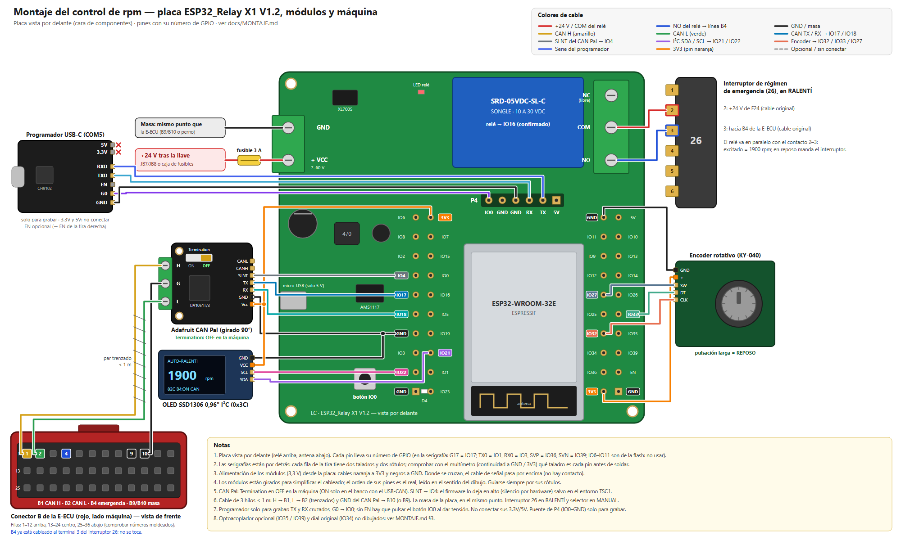

# Montaje — Control de rpm con la placa ESP32_Relay X1 V1.2

Guía de conexión con el hardware que ya tenemos. Pinout de la placa y fotos: [`HARDWARE_PLACA_ESP32_RELE.md`](HARDWARE_PLACA_ESP32_RELE.md) · plan de pruebas: [`CONTROL_RPM.md`](CONTROL_RPM.md) · pinout de la E-ECU: [`PINOUT_E-ECU.md`](PINOUT_E-ECU.md) · esquema: [`esquema_rpm_ESP32.png`](esquema_rpm_ESP32.png).

Diagrama ilustrado de todas las conexiones (fuente editable: [`esquema_montaje_ESP32.svg`](esquema_montaje_ESP32.svg)): placa vista por delante con el número de GPIO de cada pin, programador, Adafruit CAN Pal, OLED, encoder, conector B de la E-ECU, interruptor de emergencia 26 y alimentación.

## 0. Material

| Disponible | Pendiente de comprar ([`LISTA_COMPRA.md`](LISTA_COMPRA.md)) |
|---|---|
| Placa **ESP32_Relay X1 V1.2** (ESP32-WROOM-32E, relé Songle 10 A, entrada 24 V, P4 de programación) | **Módulo CAN Adafruit CAN Pal** (A3) |
| **Encoder** rotativo | **OLED SSD1306** 0,96" I²C (A7) |
| **Programador USB-C** con auto-descarga (WCH + AMS1117; pines 5V/3.3V/RXD/TXD/EN/G0/GND) | Optoacoplador 24 V → 3,3 V (A5, opcional) |
| Multímetro, cables, soldador | Adaptador **USB-CAN** para el PC (C1) · fusible en línea 3 A, caja, cable |

## 1. Preparar la placa

1. **Soldar pines macho** en los taladros que se van a usar (las dos tiras dobles están sin soldar):
   - Tira superior: **G4, G17, G18, G21, G22**, **3V3** y un **GND**.
   - Tira inferior: **G27, G32, G33**, **EN**, y si se usa el optoacoplador **G35, SVN (G39)**; opcional **G34** (dial original).
2. **Quitar el puente de P4.** En la foto frontal hay un jumper en dos pines de P4; casi seguro une **IO0 con GND**, lo que deja la placa siempre en modo carga. Comprobar con el multímetro qué dos pines une y retirarlo.
3. **Comprobar el convertidor de entrada**: leer la referencia del chip SOIC-8 junto al borne VCC/GND (se espera **XL7005A**, 5–80 V). En banco, alimentar el borne a 24 V y luego a 30 V y medir 5 V y 3,3 V estables.

## 2. Programación (programador USB-C → placa)

| Programador | Placa | Dónde | ¿Obligatorio? |
|---|---|---|---|
| **GND** | **GND** | P4 | Sí |
| **TXD** | **RX** | P4 (cruzado) | Sí |
| **RXD** | **TX** | P4 (cruzado) | Sí |
| **G0** | **IO0** | P4 | Recomendado |
| **EN** | **EN** | tira inferior | **Opcional** (recomendado) |
| 3.3V / 5V | — | — | **No conectar**: la placa se alimenta por su micro-USB o su borne VCC/GND |

**¿Por qué EN es opcional?**

| | Con EN (y G0) conectados | Sin EN |
|---|---|---|
| Cargar el programa | Se pulsa "Subir" y el programador reinicia la placa en modo carga solo | Mantener pulsado el botón **IO0** de la placa mientras se le da tensión, soltar, pulsar "Subir" y, al terminar, quitar y volver a dar tensión |
| Ver los mensajes del arranque | El PC puede reiniciar la placa | Hay que reiniciarla a mano |
| Cables | 5 (uno de ellos en la tira inferior, hay que soldar EN) | 3 o 4, todos en P4 |

Mínimo absoluto: **GND, TXD→RX, RXD→TX** (3 cables) usando el botón IO0. Recomendado durante el desarrollo: los 5, porque el programa se carga muchas veces.

Antes del primer uso: con el programador enchufado al PC, medir **TXD respecto a GND ≈ 3,3 V** (si diera 5 V, no conectarlo al ESP32).

PlatformIO: `board = esp32dev`, `upload_speed = 921600` (bajar a 115200 si falla).

## 3. Conexión de los módulos

| Módulo | Pin del módulo | Pin de la placa | Notas |
|---|---|---|---|
| **CAN Pal** (Adafruit, TJA1051T/3) | TX | **G17** | |
| | RX | **G18** | |
| | SLNT | **G4** | alto = silencio (no puede transmitir); el firmware lo deja en alto salvo en el entorno TSC1 |
| | Vcc / GND | **3V3 / GND** | |
| | H / L (bornero) | → máquina: **B1 / B2** de la E-ECU (o JB14 / JB6 del mazo de la V-ECU) | **Interruptor de terminación en OFF**; par trenzado < 1 m |
| | GND (borne central) | → **B10 (o B9)**, masa de la E-ECU | Referencia de masa común del CAN: va en el mismo cable que H/L (3 hilos) |
| **OLED SSD1306** | SDA / SCL | **G21 / G22** | dirección 0x3C |
| | VCC / GND | **3V3 / GND** | |
| **Encoder** | CLK / DT / SW | **G32 / G33 / G27** | pull-up interno en SW |
| | + / GND | **3V3 / GND** | |
| **Optoacoplador** (opcional) | OUT1 (estado de B4) / OUT2 (selector Auto/Manual) | **G35 / SVN (G39)** | entradas IN1 ← línea B4, IN2 ← terminal 2 del selector; VCC lado ESP32 = 3,3 V |
| **Dial original** (opcional) | señal 0,5–4,5 V (JA39) | **G34** | divisor 10 k / 10 k |
| **Relé de la placa** | — (interno) | **GPIO16** (confirmado) | ver §4 |

Pines que **no se usan**: G0, G2, G5, G12, G15 (pines de arranque), SD0–SD3, CLK, CMD (memoria flash), TX0/RX0 (programación).

## 4. Conexión a la máquina

| Borne de la placa | Va a | Notas |
|---|---|---|
| **VCC** | +24 V tras la llave de contacto (JB7/JB8 del mazo de la V-ECU o salida libre de la caja de fusibles) | **Fusible en línea de 3 A** |
| **GND** | Masa en el **mismo punto que la E-ECU**: B9/B10 o el perno de chasis junto a la E-ECU | Así la placa, el CAN Pal (su borne GND va a B10/B9) y la E-ECU comparten la misma referencia, sin diferencias de masa por el chasis. No alimentar otros equipos desde B9/B10 |
| Relé **COM** | Terminal **2** del interruptor de emergencia 26 (+24 V de F24) | Faston o back-probe; no cortar cables |
| Relé **NO** | Terminal **3** del interruptor de emergencia 26 (línea hacia **B4** de la E-ECU) | Relé excitado = 24 V en B4 = 1900 rpm; en reposo manda el interruptor original |
| Relé **NC** | Sin conectar | |

**Regla de seguridad:** el selector Auto/Manual se queda en **MANUAL** (válvula de la bomba a 340 mA por la Resistor Box). En Auto sin V-ECU la bomba va al máximo y el motor puede calarse.

## 5. Primeras pruebas (en la mesa, sin máquina)

1. Alimentar la placa por el micro-USB o con 24 V en el borne. Conectar el programador y cargar un programa de prueba que:
   - parpadee el relé por **GPIO16** (debe oírse el clic y medirse continuidad COM–NO) — ✅ clic confirmado con `firmware/pruebas/rele`; falta medir COM–NO. El LED de la placa es el indicador del relé (sigue a GPIO16); no hay LED en GPIO2;
   - muestre en la OLED un texto y la posición del encoder.
   - ✅ **Firmware `firmware/esp32` grabado y verificado (2026-10-19)**: arranca en Reposo, la consola serie responde (`estado`, `modo …`), el relé conmuta con `modo alto` / `modo reposo`, CAN en solo escucha y SLNT (IO4) en alto. Pendiente: OLED y encoder (sin conectar).
2. Con el módulo CAN conectado y el adaptador USB-CAN del PC unidos entre sí (en el banco, interruptor de terminación del CAN Pal en **ON**; en la máquina, en **OFF**), comprobar que el ESP32 recibe tramas a **250 kbit/s** (`estado` → «tramas rx» sube). Para probar también el envío hay que grabar el entorno `esp32dev_tsc1`; con el firmware normal el ESP32 no puede transmitir (solo escucha + SLNT en alto).
3. Ya en la máquina: conectar el CAN en **modo solo escucha** y verificar que llega EEC1 (`0x0CF00400`, rpm) con el motor en marcha. Seguir el plan de [`CONTROL_RPM.md`](CONTROL_RPM.md) §4.
